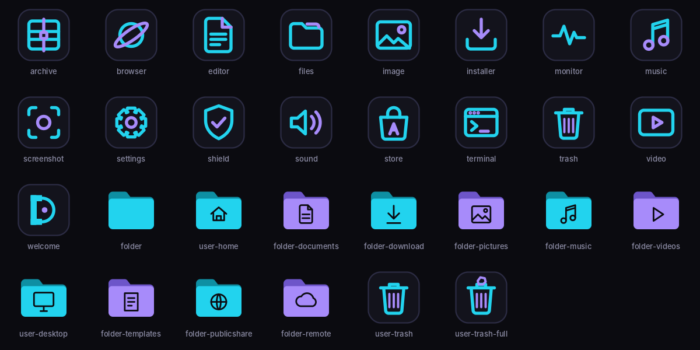

# DarkYour

**Приватная операционная система** на базе Debian 13 (trixie): тёмный неон, минимализм и простой интерфейс, к которому привыкаешь за минуту.

## Что внутри

- **Рабочий стол XFCE** со своей темой: панель снизу, меню «Пуск», тёмный неон
- **Firefox с жёсткой защитой**: без телеметрии, строгая блокировка трекеров, uBlock Origin, поиск DuckDuckGo, только HTTPS
- **Блокировка рекламы и трекеров во всей системе** (список StevenBlack/hosts)
- **Фаервол включён**: все входящие подключения закрыты
- **Случайный MAC-адрес** в Wi-Fi сетях
- **Шифрование диска** при установке (галочка в установщике)
- **Приветственное окно DarkYour** со статусом защиты
- **Установщик Calamares** с брендингом DarkYour
- Русский язык, раскладка переключается **Alt + Shift**
- **Своя тема окон и иконок DarkYour**, неоновые обои, свой экран загрузки
- **Магазин приложений** с Flathub, установка `.deb` двойным кликом
- **LibreOffice** (документы, таблицы, презентации) и **VLC**
- **Настройки DarkYour**: акцентный цвет, обои, ночной режим, переключатели защиты
- **KeePassXC**, **сейф** (SiriKali), **Tor Browser**, удаление метаданных правым кликом
- **Паник-кнопка** Win + Esc
- **Steam** (с Proton), **Wine** для `.exe`, GameMode, MangoHud
- **Резервные копии** Timeshift

Скоро: встроенный клиент **DVS VPN**.

## История версий

- **1.3** — настройки DarkYour, акцентные цвета, 4 обоев, приватность (пароли, сейф, Tor, метаданные, паник-кнопка), игры, резервные копии, авто-ускорение в виртуалке
- **1.2** — своя тема окон, новые обои, экран загрузки, магазин приложений, LibreOffice, VLC
- **1.1** — своя тема иконок
- **1.0** — первая версия

## Как получить ISO

ISO собирается автоматически на серверах GitHub при каждом изменении проекта.

1. Открой вкладку **Actions** в репозитории
2. Нажми на последнюю зелёную сборку **«Сборка DarkYour ISO»**
3. Внизу в блоке **Artifacts** скачай **DarkYour-ВЕРСИЯ-buildN**
4. Распакуй zip — внутри файл `DarkYour-ВЕРСИЯ-buildN.iso`

Пересобрать вручную: **Actions → Сборка DarkYour ISO → Run workflow**.

## Запуск в VirtualBox

1. **Создать** → имя `DarkYour`, тип **Linux**, версия **Debian (64-bit)**, выбери ISO
2. Память **4096 МБ**, процессоры **2**, диск **25 ГБ**
3. Настройки → Дисплей → видеопамять **128 МБ**, контроллер **VMSVGA**
4. **Запустить** — в меню загрузки выбери первый пункт

В live-режиме вход автоматический. Чтобы установить систему на виртуальный диск, нажми **«Установить DarkYour»** в приветственном окне.

## Структура проекта

```
auto/config                      настройки сборки
config/package-lists/            список программ
config/hooks/normal/             скрипт финальной настройки
config/includes.chroot/          файлы, которые попадают в систему
  etc/skel/.config/              оформление XFCE для каждого пользователя
  usr/bin/darkyour-welcome       приветственное окно
  usr/share/darkyour/            логотипы
  usr/share/backgrounds/         обои
scripts/build-in-docker.sh       сборка внутри Debian
scripts/make-art.py              генератор логотипа
scripts/make-wallpaper.py        генератор обоев
scripts/make-icons.py            генератор иконок
scripts/make-theme.py            генератор темы окон
scripts/make-boot.py             экран и меню загрузки
VERSION                          номер версии
.github/workflows/build.yml      автосборка на GitHub
```

## Иконки DarkYour

Своя тема иконок в неоновом стиле (SVG, генерируется скриптом `scripts/make-icons.py`).
Всё, чего нет в теме, берётся из Papirus-Dark.


